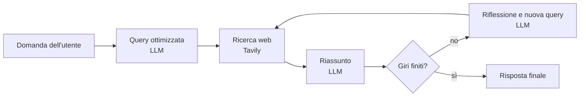

# 🔎 Info Segugio

Assistente di ricerca con intelligenza artificiale: fai una domanda e lui cerca sul web, riassume le fonti e approfondisce da solo, ripetendo la ricerca per più giri.

Realizzato da Domenico Mirabelli durante la specializzazione Coding AI di Aulab Hackademy, replicando il progetto visto nella lezione "AI Search - Info Segugio".

## Come funziona



1. **Query ottimizzata**: il modello trasforma la domanda in una query di ricerca efficace, indicando su quale aspetto si concentra e perché.
2. **Ricerca web**: Tavily restituisce fino a 5 risultati per la query.
3. **Riassunto**: il modello sintetizza i risultati. Dal secondo giro in poi estende il riassunto già scritto.
4. **Riflessione**: il modello individua una lacuna nel riassunto e propone una nuova query di approfondimento.
5. **Ciclo**: i passaggi 2-4 si ripetono fino a un massimo di giri (`max_cycles`, 3 per impostazione predefinita).
6. **Risposta finale**: viene mostrata la domanda originale con il riassunto completo.

Ogni passaggio compare in chat, così si vede cosa sta facendo e perché.

## Tecnologie

- **Python 3.13** e **Poetry** per la gestione delle dipendenze
- **Chainlit** per l'interfaccia di chat
- **Groq** come fornitore del modello di linguaggio (`openai/gpt-oss-120b`), usato con il client `openai`
- **Tavily** per la ricerca web

## Installazione

1. Installare le dipendenze:

```bash
   poetry install
```

2. Creare nella cartella del progetto un file `.env` con le due chiavi API:

```
   GROQ_API_KEY=la_tua_chiave_groq
   TAVILY_API_KEY=la_tua_chiave_tavily
```

   Il file `.env` è escluso da Git e **non va mai pubblicato**. Le chiavi si ottengono dai siti di Groq e Tavily: per entrambi esiste un piano gratuito.

3. Avviare l'applicazione:

```bash
   poetry run chainlit run src/info_segugio/__init__.py
```

4. Aprire `http://localhost:8000` nel browser.

Per sviluppare, l'opzione `-w` fa ricaricare l'app a ogni modifica ai file `.py`.

## Utilizzo

Scrivi una domanda e aspetta: una risposta completa richiede uno o due minuti, perché il modello e la ricerca vengono chiamati più volte.

**Consiglio**: più la domanda è precisa (nomi, date, luoghi), più la ricerca trova le fonti giuste. Una descrizione vaga come "il modello cinese famoso" dà risultati peggiori di "DeepSeek, gennaio 2025".

## Struttura del progetto

```
src/info_segugio/
├── __init__.py    # logica dell'applicazione e interfaccia Chainlit
├── config.py      # configurazione: modelli, indirizzo dell'API, chiavi dall'ambiente
└── prompts.py     # testi dei prompt
public/            # tema, colori e immagini dell'interfaccia
chainlit.md        # testo della pagina "Leggimi" dell'app
```

### Le funzioni principali (`__init__.py`)

| Funzione | Cosa fa |
|---|---|
| `llm` | Chiama il modello. Il formato JSON viene richiesto solo quando serve |
| `optimize_search_query` | Genera la query ottimizzata, con la data di oggi nel prompt |
| `web_research` | Esegue la ricerca con Tavily e restituisce fonti e contenuti |
| `summarize_sources` | Crea o estende il riassunto |
| `reflect_on_summary` | Individua una lacuna e propone la query successiva |
| `main` | Gestisce la conversazione: Fase 1 (query), Fase 2 (ciclo) e Fase 3 (risposta finale) |

## Prompt

I testi sono in `src/info_segugio/prompts.py` e sono di tre tipi:

- **Query Writer** (`query_writer_instructions`): trasforma la domanda in una query di ricerca e risponde con un JSON con `query`, `aspect` e `reason`
- **Summarizer** (`summarizer_instructions`): sintetizza le informazioni, creando un riassunto nuovo o estendendo quello esistente
- **Reflection** (`reflection_instructions`): analizza il riassunto e risponde con un JSON con `lacuna_conoscenza` e `domanda_approfondimento`

## Personalizzazione

- **Numero di giri**: variabile `max_cycles` nella funzione `main`. Ogni giro consuma crediti Tavily e chiamate al modello.
- **Modello**: valori `LLM_MODEL` e `LLM_MODEL_LOW` in `config.py`.
- **Grafica**: i colori sono in `public/theme.json` (tema chiaro e scuro) e i ritocchi sui singoli elementi in `public/app.css`.

## Differenze rispetto al corso

- Al posto di OpenAI viene usato **Groq**, con lo stesso client `openai` puntato all'indirizzo di Groq. Il ruolo dei messaggi di istruzioni è `system`.
- Le chiavi sono lette dalle variabili d'ambiente (file `.env`) e non sono scritte nel codice.
- La funzione `llm` aggiunge il formato JSON solo quando richiesto, così il riassunto può essere testo libero.
- Il prompt della query riceve la data di oggi e mantiene il periodo indicato dall'utente.
- Interfaccia con tema personalizzato: blu scuro, messaggi dell'utente in arancione.

## Limiti noti

- Il riassunto dipende dalle fonti trovate da Tavily. Se la fonte è generica o di un'altra epoca, il modello può mescolare date ed eventi: i dati importanti vanno **sempre controllati sulle fonti**.
- Le query di approfondimento generate dal modello